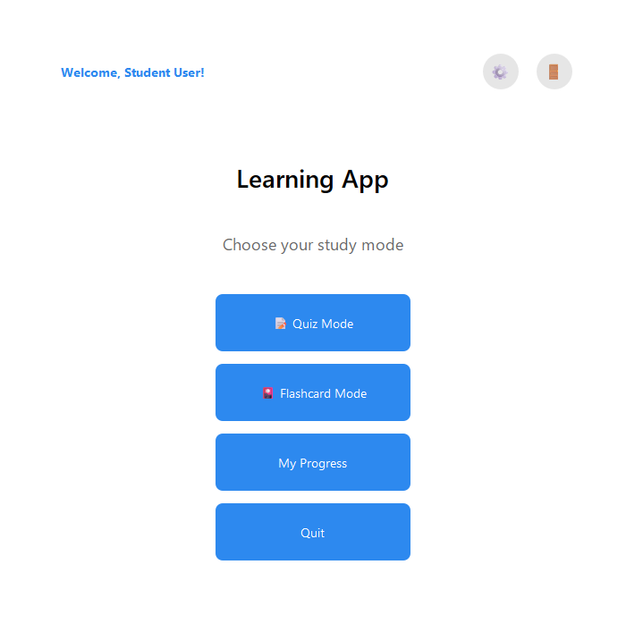
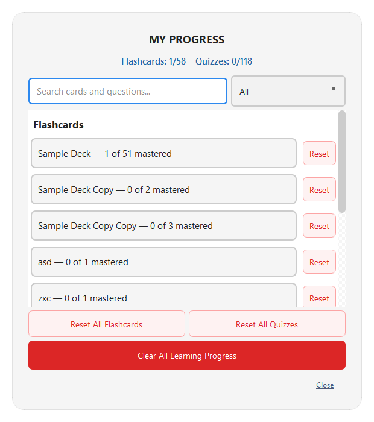
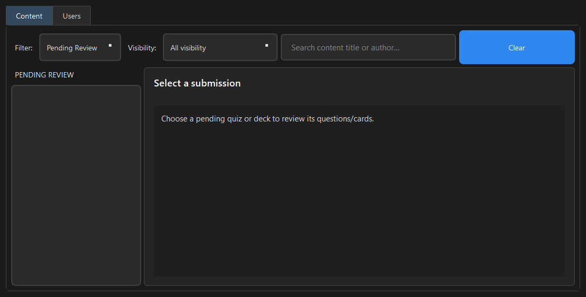

# Study Buddy

Study Buddy is a local desktop learning application built with Python and
PyQt6. It combines quizzes, adaptive flashcards, progress tracking, content
editing, class invitations, and role-based moderation in one offline-first
application.

## Features

- Six quiz question types: single choice, multiple choice, true/false, short
  answer, matching, and ordering.
- Adaptive flashcard sessions with weighted review, delayed retries, mastery
  tracking, recorded audio, and offline text-to-speech.
- Per-user quiz and flashcard progress, statistics, search, filtering, and
  reset controls.
- Quiz and flashcard editors with image/audio media management and draft,
  class-only, and public visibility.
- Student, teacher, and administrator roles with account and content
  moderation rules.
- Class-only content shared through revocable invitation codes, with teacher
  roster and access management.
- Dedicated quiz Test Mode with persistent attempt history, configurable
  countdown timers, due dates, passing grades, attempt limits, saved pass/fail
  results, explicit interrupted-attempt handling, and teacher-controlled answer
  review.
- Teacher assessment reporting with best/average grades, class averages,
  per-question analytics, submission inspection, and CSV result exports.
- Persistent light/dark themes and English/French language preferences.
- Pluggable repositories: JSON provides the offline/demo mode, while the
  authenticated desktop can route accounts, content, classes, learning state,
  moderation, and audit history through FastAPI to PostgreSQL. Database
  credentials remain on the server.

## Screenshots

| Learner dashboard | Progress tracking |
|---|---|
|  |  |



Additional screens are available in [`docs/screenshots/`](docs/screenshots/).

## Technologies

- Python 3.10+
- PyQt6 and Qt Multimedia/Text-to-Speech
- QSS light and dark themes
- JSON persistence
- FastAPI and Uvicorn (authenticated application API)
- SQLAlchemy 2, Alembic, psycopg, and PostgreSQL (incremental migration)
- pytest
- Git and GitHub

## Architecture

```text
PyQt6 UI
   -> Controllers
      -> Learning logic and access rules
         -> Repository contracts
            -> JSON, PostgreSQL, or the staged HTTP API
```

The UI delegates application flow to controllers, while repositories own file
access and persistence. Shared configuration and access definitions prevent
paths, roles, visibility values, and lifecycle states from being duplicated.

See [docs/architecture.md](docs/architecture.md) for the detailed component and
storage design.

## Project structure

```text
StudyBuddy/
|-- data/                 # Content, users, settings, progress, and media
|-- docs/                 # Architecture, testing, and screenshots
|-- src/
|   |-- api/              # FastAPI application endpoints
|   |-- controllers/      # Application coordination
|   |-- logic/            # Learning and permission rules
|   |-- storage/          # Repository contracts and JSON/PostgreSQL/HTTP adapters
|   |-- ui/               # PyQt6 windows and dialogs
|   `-- utils/            # Paths, logging, audio, and TTS
|-- migrations/           # Alembic database migrations
|-- styles/               # Dark and light QSS themes
|-- tests/                # Automated pytest suite
|-- requirements.txt
`-- run_tests.py
```

The complete layout is documented in
[docs/architecture.md](docs/architecture.md#project-layout).

## Installation

Windows is the primary supported platform. From PowerShell in the project
directory:

```powershell
py -m venv .venv
.\.venv\Scripts\python.exe -m pip install --upgrade pip
.\.venv\Scripts\python.exe -m pip install -r requirements.txt
.\.venv\Scripts\python.exe -m src.main
```

Qt uses the system's configured output device for recorded audio and local
text-to-speech.

## Testing

Install the development dependencies and run:

```powershell
.\.venv\Scripts\python.exe -m pip install -r requirements-dev.txt
.\.venv\Scripts\python.exe run_tests.py
```

Test counts and coverage are revision- and environment-specific, especially
for PostgreSQL-gated tests. The normal command prints the authoritative
pass/fail/skip and coverage result for the current checkout. It enforces
controller, Quiz/Test Mode controller, and utility regression floors of 80%,
80%, and 90%. Coverage reports are written to
`.temp/coverage/htmlcov/index.html`; visual PyQt and real-device output remain
manual.

See [docs/testing.md](docs/testing.md) for the complete test inventory and
testing strategy, and [the project status report](docs/project_status.md) for
the last recorded results and their limitations.

## Phase 7 read-stress evidence

Phase 7 uses a disposable `study_buddy_test` PostgreSQL database and an
isolated fixture; it never targets normal application data. The September 2026
read-scaling work confirmed and removed two small pieces of unnecessary work:
learner preview no longer loads short-answer variants that are immediately
redacted, and quiz practice no longer builds an image-path projection that its
media-descriptor pass replaces. The post-change local matrix and 30-minute
soak completed without unexpected HTTP results, but also improved untouched
endpoints. That makes the local result unsuitable as proof that either change
caused the former c=25–32 knee. The next comparison is the same workload on a
second workstation. See [the Phase 7 live stress report](docs/phase7-live-stress-report.md)
and [the soak-test history](docs/performance/soak_test_history.md) for
provenance, completed work, artifacts, and limits of interpretation.

## Offline Library and updates

Phase 5 provides the local offline-library foundation. It does not provide full
synchronization or automatic content updates. The implementation keeps bundled
demo and existing JSON content separate from explicitly downloaded public,
class, or private content, with account-aware access and a separate
**Clear Downloaded Data** action.

Phase 6 added server-authoritative content versions, explicit refresh,
offline-practice packages, downloaded media, and media-aware offline
availability/error handling. It still does not provide full synchronization or
automatic content updates. See [the storage-mode documentation](docs/storage-modes.md)
for supported behaviour and deferred cache hardening work.

## Documentation

- [Architecture and project structure](docs/architecture.md)
- [PostgreSQL migration and local setup](docs/database.md)
- [Proposed PostgreSQL ER diagram](docs/study_buddy_erd.md)
- [Testing strategy and test inventory](docs/testing.md)
- [Current project status](docs/project_status.md)
- [Prioritized roadmap](docs/roadmap.md)
- [Phase 7 live stress-test report](docs/phase7-live-stress-report.md)
- [Phase 7 soak-test history](docs/performance/soak_test_history.md)
- [Screenshot catalog](docs/screenshots/README.md)
